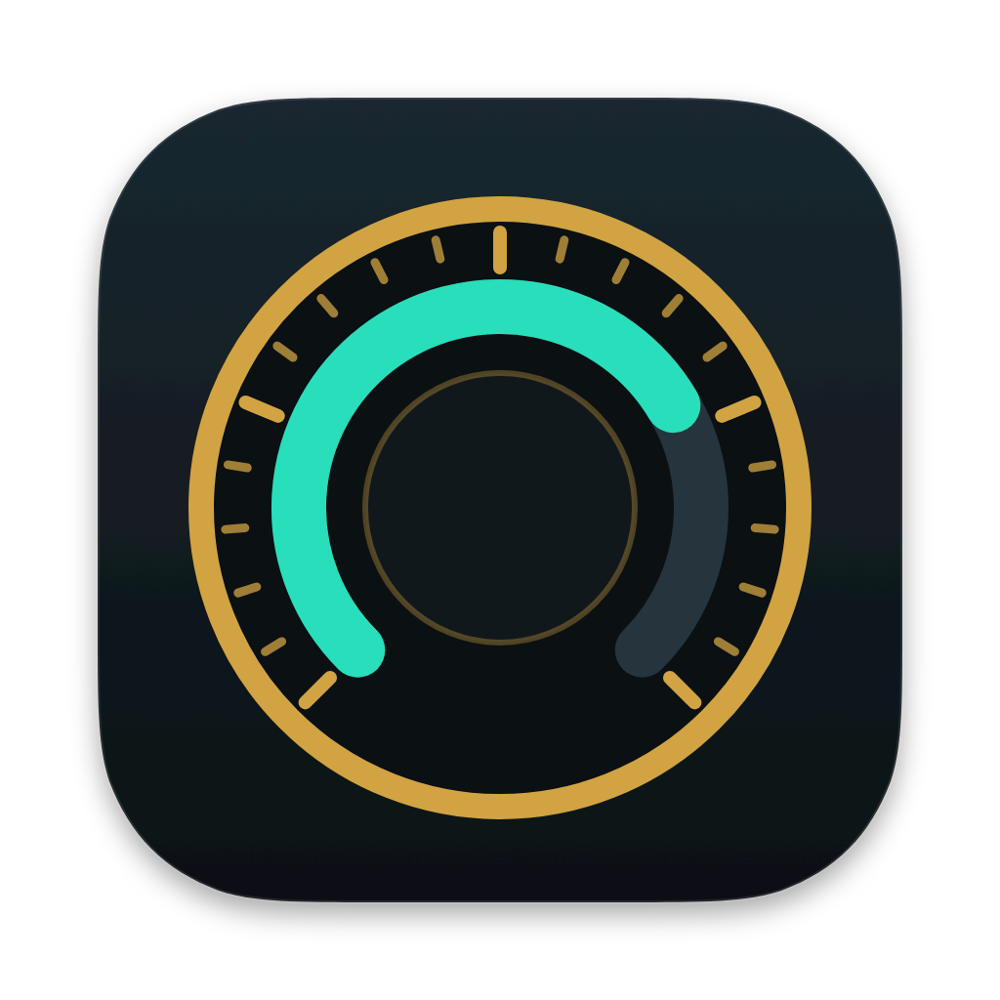
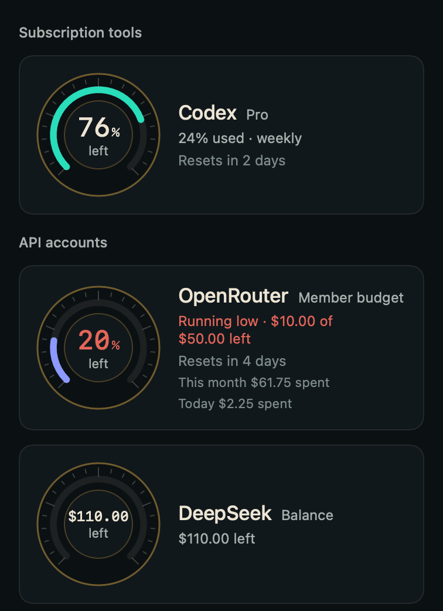
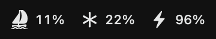
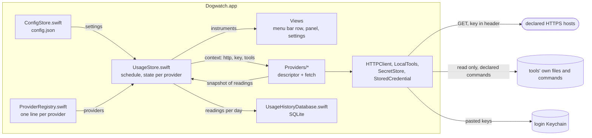

<p align="center"></p>

# Dogwatch

<p align="center"><a href="https://preacherxp.github.io/30-days-of-tools/"></a></p>

<p align="center"><a href="https://buymeacoffee.com/michal.hachula"></a></p>

A macOS menu bar app for people who use AI coding tools and model APIs, that shows how much of each subscription's allowance or each account's balance is left, and when it resets.

The menu bar shows each provider you switched on as its icon and what is left, such as a sailboat and `76%` for Codex next to an asterisk and `18%` for Claude, or `$12.40` for an API balance. Click it and a panel opens with a gauge per provider: the percentage left, how much is used and over which window, and when it resets. The windows are whatever your subscription has, as the provider reports them: a five-hour session and a week on some plans, only a week on others, a model-specific weekly limit on some. When a provider has more than one limit, the one you are hitting is the gauge and the others are bars under it, and anything at 20% or less turns red and says **Running low**. API accounts show balances and spend in their own currency, as a percentage only when there is a real total to measure against. A logbook keeps the last 7, 30 or 90 days in a local SQLite file. Built-in providers read what your tools already keep on your Mac or call the provider with a key you paste; Dogwatch never refreshes another tool's sign-in.

<p align="center"></p>

## Requirements

- macOS 13 or later
- Swift 5.10 or later to build it: Xcode 15.3 or later, or the Command Line Tools
- For each provider you switch on, what the table under [Providers](#providers) says it needs: the tool installed and signed in on the same Mac, or a key you paste into settings.

## Install

```sh
git clone https://github.com/preacherxp/dogwatch.git
cd dogwatch
./build-app.sh
cp -R "dist/Dogwatch.app" /Applications/
open "/Applications/Dogwatch.app"
```

`build-app.sh` makes a release build for your Mac's architecture and signs the bundle ad hoc. The app has no Dock icon; look for the provider icons and percentages in the menu bar. To start it at login, turn on **Start at login** under the gear button > **General settings…**; macOS may ask you to approve it in **System Settings** > **General** > **Login Items**.

The app is not signed with a Developer ID or notarised. A copy you build yourself opens normally. A copy downloaded from somewhere else is blocked by Gatekeeper: open it once with right click > **Open**, or allow it under **System Settings** > **Privacy & Security**, or remove the quarantine flag with `xattr -dr com.apple.quarantine "/Applications/Dogwatch.app"`.

To update, `git pull` and run the same commands again. To uninstall, remove any pasted keys under each provider's settings (**Remove**), choose the power button in settings, delete the app, and remove what it keeps:

```sh
rm -rf "/Applications/Dogwatch.app"
rm -rf ~/Library/Application\ Support/Dogwatch   # config.json and usage history
defaults delete dev.dogwatch.app                    # menu bar placement
rm -rf ~/Library/Caches/dev.dogwatch.app ~/Library/HTTPStorages/dev.dogwatch.app
```

### Troubleshooting

- **The app quits as soon as it starts.** macOS has hidden its menu bar item, and a menu bar app with no visible item closes. Turn **Dogwatch** back on under **System Settings** > **Menu Bar**. `defaults read dev.dogwatch.app` shows `"NSStatusItem VisibleCC Item-0" = 0` when the item is hidden.
- **A provider says "sign in again".** That tool's stored sign-in has expired. Open the tool once so it refreshes its own login, then press the refresh button. Dogwatch never refreshes another tool's sign-in.
- **A message about config.json at the top of the panel.** The file has a value Dogwatch can't use; the message names it, and defaults are used for that value until you fix it.

## Usage

Click the menu bar item to open the panel. Each provider refreshes when the panel opens (at most once a minute) and on its own interval in the background, five minutes unless you change it.

<p align="center"></p>

The menu bar item lists the providers set to appear there, in the order of the settings page, each as its icon and what is left: a percentage, or an amount such as `$12.40` when there is no total. A dash means no reading yet, and an ellipsis means the first reading is still loading. VoiceOver and the tooltip read the whole row, for example "Codex 11% remaining, Claude 22% remaining, Grok 96% remaining". With many providers, keep it short with **At most** or **Lowest** in general settings; the row is capped in width either way.

| Control | Action |
| --- | --- |
| Arrow button | Refresh now, including providers waiting for you after a denied Keychain prompt |
| Chart button | Open the usage logbook: **7D**, **30D** or **90D** |
| Gear button | Providers: search, switch on or off, drag to reorder, open one for its settings; **General settings…**; **Add a custom provider…** |

- **Readings.** A provider can report several: quota windows (a share used, resetting at a time), balances (money or credits left, sometimes out of a total) and spend (money used over a period, sometimes against a budget). The gauge shows the primary one: the one the provider marks as binding, else the one that runs out first, or the one you pick in that provider's settings.
- **Percentages are never guessed.** A balance or spend becomes a percentage only against a total the provider reports, or one you type in its settings (an allowance the provider doesn't publish, or your own budget). Otherwise the gauge shows the amount.
- **Exact numbers.** Codex reports exact token counts, shown as **Today**, **All time** and a seven-day chart. Other providers report percentages or amounts, which is what Dogwatch shows and stores.
- **Panel.** Up to four providers get a full gauge each; more get compact rows, grouped into **Subscription tools** and **API accounts**, and the list scrolls past a fixed height.
- **Themes.** **Nautical** (gauges), **Ledger** and **Night City**. All three are dark.

### Providers

<!-- providers:start -->
| Provider | Source | Shows | Needs |
| --- | --- | --- | --- |
| AI/ML API (`aimlapi`) | AI/ML API `GET /v2/billing` | Balance (USD) | Your API key, pasted in settings |
| Anthropic API (`anthropic-api`) | Anthropic Admin API `GET /v1/organizations/cost_report` | Organization spend this month and today | Your Admin API key, pasted in settings |
| Antigravity (`antigravity`) | Antigravity CLI status line (`quota`), written to a file | Five-hour and weekly quota per model group | The tool's local data |
| Claude (`claude`) | Claude Code's usage endpoint, with Claude Code's Keychain sign-in | Claude Code limits: weekly, and five-hour if your plan has one | Its own sign-in (Keychain, read only) |
| Cline (`cline`) | Cline API `GET /api/v1/users/{id}/balance` | Cline credit balance (pay-as-you-go), personal or an organisation's | Your Cline API key, pasted in settings |
| Codex (`codex`) | Codex app server (local process) | ChatGPT allowance, tokens, and credits | Its own sign-in (file, read only) |
| GitHub Copilot (`copilot`) | Copilot's own quota endpoint, with the Copilot plugins' sign-in | Monthly Copilot quotas and AI credits used | Its own sign-in (file, read only) |
| Cursor (`cursor`) | cursor.com dashboard endpoints, with a pasted cookie or Cursor's own sign-in (opt-in) | Weekly pool or monthly included usage, and on-demand spend | Your cursor.com cookie, pasted in settings |
| Deepgram (`deepgram`) | Deepgram API `GET /v1/projects/{id}/balances` | Project balance | Your API key, pasted in settings |
| DeepInfra (`deepinfra`) | DeepInfra API `GET /payment/usage`, `/payment/key-limits`, `/payment/config` | Spend this month, key limits and account limit | Your API key, pasted in settings |
| DeepSeek (`deepseek`) | DeepSeek API `GET /user/balance` | Prepaid balance (CNY or USD) | Your API key, pasted in settings |
| Devin (`devin`) | Devin Desktop's local plan cache | Devin Desktop daily and weekly quota | The tool's local data |
| ElevenLabs (`elevenlabs`) | ElevenLabs API `GET /v1/user/subscription` | Credits used of the plan's limit, with reset | Your API key, pasted in settings |
| Droid (`factory`) | Factory web app endpoint `GET /api/billing/limits` | Rolling 5-hour, 7-day and 30-day limits, and Extra Usage balance | Your Factory API key, pasted in settings |
| fal (`fal`) | fal Platform API `GET /v1/account/billing` | Credit balance | Your API key, pasted in settings |
| Fireworks AI (`fireworks`) | Fireworks API `GET /v1/accounts/{id}/billing/summary` | Account spend this month and today | Your API key, pasted in settings |
| Gemini CLI (`gemini-cli`) | Gemini CLI's quota lookup, with Gemini CLI's stored sign-in | Daily request quota per model (Workspace and Code Assist accounts) | Its own sign-in (file, read only) |
| Grok (`grok`) | Grok's local log (written when you run /usage) | Grok Build weekly credits and prepaid balance | The tool's local data |
| Hugging Face (`huggingface`) | Hugging Face Hub API `GET /api/organizations/{name}/billing/usage/inference` | Organization Inference Providers spend this month (Enterprise) | Your Access token, pasted in settings |
| Hyperbolic (`hyperbolic`) | Hyperbolic API `GET /v2/customer/balance` | Credit balance (USD) | Your API key, pasted in settings |
| JetBrains AI (`jetbrains`) | The IDE's saved AI quota (local file) | AI Assistant and Junie monthly AI credits and top-ups | The tool's local data |
| Kilo Code (`kilo`) | Kilo `GET /api/profile/balance` (what the Kilo CLI reads) | Kilo credit balance (Kilo Pass and top-ups) | Your Kilo API key, pasted in settings |
| Kimi Code (`kimi`) | Kimi Code `GET /coding/v1/usages` (what the Kimi Code CLI's /usage reads) | Kimi Code membership quota windows | Your Kimi Code API key, pasted in settings |
| Kiro (`kiro`) | Kiro CLI's GetUsageLimits lookup, with Kiro CLI's stored sign-in | Monthly credits used of your plan, and overage | Its own sign-in (file, read only) |
| LiteLLM proxy (`litellm`) | LiteLLM proxy `GET /key/info` | Key spend against its budget, with reset (self-hosted) | Your LiteLLM virtual key, pasted in settings |
| Lovable (`lovable`) | Lovable API `GET /v1/workspaces/{id}/credits/balance` | Workspace credits left (Business plan or higher) | Your Lovable API key, pasted in settings |
| MiniMax (`minimax`) | MiniMax `GET /v1/token_plan/remains` (M Plan FAQ; fields from MiniMax's `mmx` CLI) | M Plan 5-hour and weekly quota left, per model | Your M Plan API key, pasted in settings |
| Mistral API (`mistral-api`) | Mistral Admin API `GET /v1/admin/spend-limit` (beta) | Usage this month against the spend limit (Enterprise) | Your Admin API key, pasted in settings |
| Kimi API (Moonshot) (`moonshot`) | Moonshot API `GET /v1/users/me/balance` | Available balance, voucher and cash (USD or CNY by region) | Your API key, pasted in settings |
| Novita AI (`novita`) | Novita API `GET /openapi/v1/billing/balance/detail` | Available balance and cash (USD) | Your API key, pasted in settings |
| Ollama Cloud (`ollama-cloud`) | Ollama API `GET /api/balance` | Included credits or session and weekly limits, plus purchased credits | Your API key, pasted in settings |
| OpenAI API (`openai`) | OpenAI Admin API `GET /v1/organization/costs` | Organization spend this month and today | Your Admin key, pasted in settings |
| OpenCode Go (`opencode-go`) | OpenCode's Go usage endpoint, with OpenCode's stored sign-in | Go plan 5-hour, weekly and monthly limits | Its own sign-in (file, read only) |
| OpenRouter (`openrouter`) | OpenRouter API `GET /api/v1/key` | Key credit limit, budgets and spend | Your API key, pasted in settings |
| Poe (`poe`) | Poe API `GET /usage/current_balance` | Point balance | Your API key, pasted in settings |
| Stability AI (`stability`) | Stability API `GET /v1/user/balance` | Credit balance | Your API key, pasted in settings |
| Together AI (`together`) | Together API `GET /v1/billing/usage` (beta) | Organization spend this month and today | Your API key, pasted in settings |
| v0 (`v0`) | v0 Platform API `GET /v1/user/billing`, `GET /v1/rate-limits` | Credit balance, on-demand credits and the free daily message limit | Your v0 API key, pasted in settings |
| Venice AI (`venice`) | Venice API `GET /api/v1/billing/balance` (beta) | USD, DIEM and credit balances | Your API key, pasted in settings |
| Vercel AI Gateway (`vercel-ai-gateway`) | AI Gateway API `GET /v1/credits` | Credit balance, Token Pass and lifetime spend (USD) | Your AI Gateway API key, pasted in settings |
| Z.ai (`zai`) | Z.ai `GET /api/monitor/usage/quota/limit` (used by Z.ai's usage plugin) | GLM Coding Plan 5-hour and weekly quota, and MCP calls this month | Your Coding Plan API key, pasted in settings |
<!-- providers:end -->

Each provider's settings say exactly what it reads and, if it runs a program, which one.

Only Codex, Claude and Grok are on for a new install; the rest start off, and fetch nothing until you switch them on.

### What it reads and where it goes

- **Codex** starts `codex app-server --stdio` and asks it `account/rateLimits/read` and `account/usage/read`; Codex makes its own requests. Before that, Dogwatch reads only the access token's expiry from `~/.codex/auth.json`, and doesn't start Codex when Codex would refresh its sign-in.
- **Claude** reads the `Claude Code-credentials` item in your login Keychain with `/usr/bin/security` and sends the token only as the `Authorization` header of `GET https://api.anthropic.com/api/oauth/usage`.
- **Grok** reads the last 1 MB of `~/.grok/logs/unified.jsonl`. Nothing is sent, and Grok is never started.
- **Pasted keys and cookies** (API providers, Cursor's optional session cookie, custom providers) are stored in your login Keychain under the service `Dogwatch provider keys`, one item per provider, and sent only in the request header to the provider's declared host. They never appear in `config.json`, the history database, errors or logs.

Every request goes through one client that calls only the hosts a provider declares, over HTTPS (plain HTTP only to `localhost`), with no disk cache, no cookies and no credential store, and refuses redirects. Usage history goes to `~/Library/Application Support/Dogwatch/usage-history.sqlite3`: one row per provider, reading and day, kept for 400 days.

### Optional: Claude status line fallback

If the Keychain token is missing, expired or the request fails, Dogwatch falls back to `~/Library/Application Support/Dogwatch/claude-rate-limits.json` if that file exists. Nothing creates it for you. To keep it current, have your Claude Code [status line](https://code.claude.com/docs/en/statusline) script save the `rate_limits` object it receives. This one needs [`jq`](https://jqlang.org/):

```sh
#!/bin/sh
input=$(cat)
limits=$(printf '%s' "$input" | jq -c '.rate_limits // empty')
[ -n "$limits" ] && printf '%s\n' "$limits" > "$HOME/Library/Application Support/Dogwatch/claude-rate-limits.json"
printf '%s' "$input" | jq -r '.model.display_name'
```

Claude Code only includes `rate_limits` for claude.ai subscribers and only after the first response in a session, so the file is as fresh as your last Claude Code message.

## Configuration

Settings live in `~/Library/Application Support/Dogwatch/config.json`, written by the settings page and read at launch and whenever it changes (within 15 seconds). You can edit it by hand; **General settings…** > **Show config.json in Finder** opens its folder. Settings from older versions are moved into it once, the first time it is created. A value Dogwatch can't use is replaced by its default and named in a message at the top of the panel; if the whole file can't be read, defaults are used and the file is copied to `config.broken.json` before the app ever saves over it. Keys Dogwatch doesn't know are kept as they are.

```json
{
  "version": 1,
  "refreshMinutes": 5,
  "theme": "nautical",
  "percentage": "left",
  "amounts": "compact",
  "launchAtLogin": false,
  "menuBar": { "show": "all", "maxItems": 4 },
  "providers": [
    { "id": "codex", "enabled": true, "menuBar": true },
    { "id": "claude", "enabled": true, "menuBar": true, "primary": "seven_day", "warnAt": 15 },
    { "id": "openrouter", "enabled": true, "menuBar": false, "refreshMinutes": 10, "limits": { "spend_month": 25 } }
  ],
  "customProviders": []
}
```

| Key | Meaning |
| --- | --- |
| `refreshMinutes` | Minutes between background refreshes, 1 to 1440. A provider is never read more often than its own minimum. |
| `theme` | `nautical`, `ledger` or `cyber` (Night City). |
| `percentage` | `left` or `used`, for every gauge and the menu bar. |
| `amounts` | `compact` (`$1.2k`) or `full` (`$1,200.00`). |
| `launchAtLogin` | Start at login, through macOS's login items. |
| `menuBar.show` | `all` providers set to appear there, or only the `lowest`. |
| `menuBar.maxItems` | At most this many providers in the menu bar. |
| `providers` | Switched-on providers in display order; a provider not listed is off. |
| `providers[].primary` | The reading the gauge shows, by id (each provider's settings list them). |
| `providers[].percentage`, `warnAt`, `refreshMinutes`, `label` | Per-provider versions of the above; `warnAt` is the percentage left that turns it red. |
| `providers[].limits` | Totals you type for readings the provider gives none for, by reading id: an allowance, or a budget for spend. |
| `providers[].settings` | Non-secret values a provider asks for, such as a team or project id. |
| `providers[].baseURL` | A regional endpoint, or your own gateway for providers that accept one. |

### Custom providers

For an endpoint Dogwatch doesn't know, add a custom provider under **Add a custom provider…**, or write it in `customProviders`. It is one HTTPS GET (or plain HTTP to `localhost`) with your key in a header, and JSON paths to the numbers:

```json
{
  "id": "custom-novita",
  "name": "Novita AI",
  "url": "https://api.novita.ai/openapi/v1/billing/balance/detail",
  "headers": { "Authorization": "Bearer {key}" },
  "okWhen": { "path": "base_resp.status_code", "equals": 0 },
  "errorMessage": "base_resp.status_msg",
  "readings": [
    { "id": "balance", "name": "Balance", "kind": "balance",
      "remaining": "availableBalance", "unit": "USD", "scale": 0.0001 }
  ],
  "refreshMinutes": 5
}
```

- `{key}` is replaced by the key you paste in the provider's settings, from the Keychain. It may appear only in a header, never in the URL.
- Each reading is a `window` (`usedPercent`, with `fraction: true` for 0–1 values; or `used` and `limit`; or `remaining` and `total`), a `balance` (`remaining`, optional `total`) or a `spend` (`amount`, optional `budget`).
- Paths look like `data.balance`, `limits[0].percent` or `$.data.usage`. Numbers may be JSON numbers or numeric strings. `unit` is a currency code, `credits`, `tokens`, `requests`, any other word, or a path to one. `scale` multiplies every amount (`0.01` for cents); `flipSign` negates them. `reset` is a path to an ISO 8601 date or epoch seconds or milliseconds (`resetFormat` to be explicit). `period` names the window or spend period.
- `okWhen` checks a value in the answer, for APIs that report errors with HTTP 200; `errorMessage` is where to find their message.
- A wrong path shows as an error naming the path; a `null` value means that reading is left out.
- More options, each described with an example in [Adding a provider](docs/ADDING-A-PROVIDER.md#declarative-options): `[field=value]` filters in paths, `optional` readings, a setting in the URL or a header (`{field:org}` with a `fields` entry), `keyKind` (`apiKey`, `adminKey`, `token`, `cookie`), a `period` read from the answer (`"$.period"`), `remainingPercent`, `nullIsZero`, `primaryFrom`, `minimumRefreshMinutes` and a `tint` colour.

## Limits

- Several sources are not documented public APIs: Claude's usage endpoint, the Codex app server's account methods, and Grok's log line. Each can change or disappear with an update; the provider then shows an error until Dogwatch is updated. The table marks each provider's stability.
- Dogwatch never refreshes, rotates or writes another tool's sign-in, starts a login or opens a browser. An expired login shows as "sign in again" until you open that tool.
- Codex is started only when its stored access token is more than 30 minutes from expiry, so Codex itself has nothing to refresh. If Codex's server rejects a token that hasn't expired, Codex may still refresh it on its own.
- Allowances are the provider's percentages, rounded to whole numbers. Amounts are converted from the provider's units (cents, ten-thousandths of a dollar) as the provider documents them.
- Claude's usage endpoint sends `"five_hour": null` for a plan without a five-hour limit, so Dogwatch shows the week there. The status line fallback can't tell that apart from a five-hour window that just expired, because Claude Code drops expired windows; Dogwatch then shows the week too, which may understate a fresh five-hour window but never overstates what is left.
- Grok updates only when the Grok CLI writes a new billing line, which happens when you run `/usage` in it.
- If you deny a Keychain prompt for another tool's item, Dogwatch doesn't ask again until you press the refresh button.
- Keys you paste are stored by this build of the app. Because it is signed ad hoc, a rebuilt app is a different app to the Keychain, which may ask once whether the new build may read them.
- Custom providers cover one GET with JSON at fixed paths. APIs that need several requests, sums over pages or a POST need a built-in provider.
- Most providers are built from their provider's documentation. If a reading shows an error or a number that doesn't match the provider's own dashboard, please open an issue.
- Admin keys for OpenAI, Anthropic and Mistral, and API keys for Together and Fireworks, can do more than read usage; those providers have no read-only key. Their settings say so: create a key just for Dogwatch, with an expiry.
- Cursor's session cookie gives full access to the Cursor account and can stop working at any time. Reading Cursor's own sign-in instead is off by default and makes macOS ask whether Dogwatch may read Cursor's stored password.
- API spend reports (OpenAI, Anthropic, Together, Fireworks, Hugging Face) can lag live usage by hours or a day; each says how fresh it is.
- The app is unsigned (ad hoc only) and built for the architecture of the Mac that builds it.

## Architecture



- **`Core/`** defines a provider: `ProviderDescriptor` (identity, glyph, what it needs and reads, declared hosts and commands, minimum refresh), `UsageProvider` (`availability` and `fetch`), `ProviderSnapshot` and its `Reading`s (window, balance, spend), and `ProviderError`, a typed failure with a message the panel shows as is.
- **`Providers/`** holds one file per provider and `ProviderRegistry.swift`, the list of built-ins. `Providers/Declarative/` runs JSON definitions: the user's custom providers, and built-ins whose API is one flat answer.
- **`Plumbing/`** is everything a provider may touch: `HTTPClient` (declared hosts only, HTTPS, no cache or cookies, no redirects, typed errors), `LocalTools` (read files and logs, run only declared commands without a shell, no browser), `SecretStore` (the Keychain), `StoredCredential` (another tool's token as stored, with its expiry checked locally) and `JSONValue` (safe paths).
- **`UsageStore.swift`** fetches every switched-on provider concurrently, each with its own interval, timeout and state, so a slow or failing one never delays another; nothing runs for a provider that is off.
- **`BridgeInstruments.swift`** turns a snapshot and its settings into what every design draws: the primary reading, other limits as bars, balances and spend as notes, and the menu bar's value.
- **`DogwatchApp.swift`** draws the menu bar row into one template image, because a `MenuBarExtra` label shows only its first icon and text.
- **`UsageHistoryDatabase.swift`** stores readings per day with a schema version. Version 1 files are upgraded in one transaction after a backup copy (`usage-history.v1-backup.sqlite3`), and the row counts are checked before the old table is dropped.
- **`NauticalDashboardView.swift`**, **`DashboardVariants.swift`**, **`UsageStatsView.swift`** and **`HarnessSettingsView.swift`** are the panel, the other two themes, the logbook and settings.

Dogwatch changes nothing outside its own files: `config.json`, the history database, its Keychain items, and processes it starts and stops. To add a provider, see [docs/ADDING-A-PROVIDER.md](docs/ADDING-A-PROVIDER.md).

## Development

```sh
swift build                                          # debug build
swift test                                           # every test: providers, contract, store, config, history, layout
swift test --filter OpenRouterProviderTests          # one provider's tests
swift run Dogwatch                                   # run from the terminal
DOGWATCH_DESIGN_PREVIEWS=/tmp/previews swift test    # also write PNGs of every theme with sample data
./build-app.sh                                       # release build to dist/Dogwatch.app
scripts/make-icon.sh                                 # rebuild Support/AppIcon.icns and docs/icon.png from the SVGs
```

Tests use fixture answers in `Tests/DogwatchTests/Fixtures/`, a recording HTTP transport and a recording command gate, so they make no network calls, start no tools and write nothing to your preferences or Keychain. `testFindsNodeOutsideGUIPath` expects `node` to be installed. `ReadmeProviderTableTests` checks the providers table above against the registry; when it fails it prints the table to paste. The README screenshot is `nautical.png` from the previews run, which uses made-up sample numbers. The icon is the dashboard's gauge drawn as SVG: `Support/AppIcon.svg` for 128 px and up, and `Support/AppIcon-small.svg`, drawn separately for 16 to 64 px with no ticks or centre well and a heavier ring and arc. `scripts/make-icon.sh` renders them with headless Chrome (set `CHROME=` to use another copy) and builds the `.icns` with `iconutil`. The version lives in `Support/Info.plist` and in the `clientInfo` that `CodexProvider.swift` sends to Codex.

## License

[MIT](LICENSE)

<sub>If it saves you from finding out mid-task that your allowance ran out, you can [buy me a coffee](https://buymeacoffee.com/michal.hachula).</sub>
